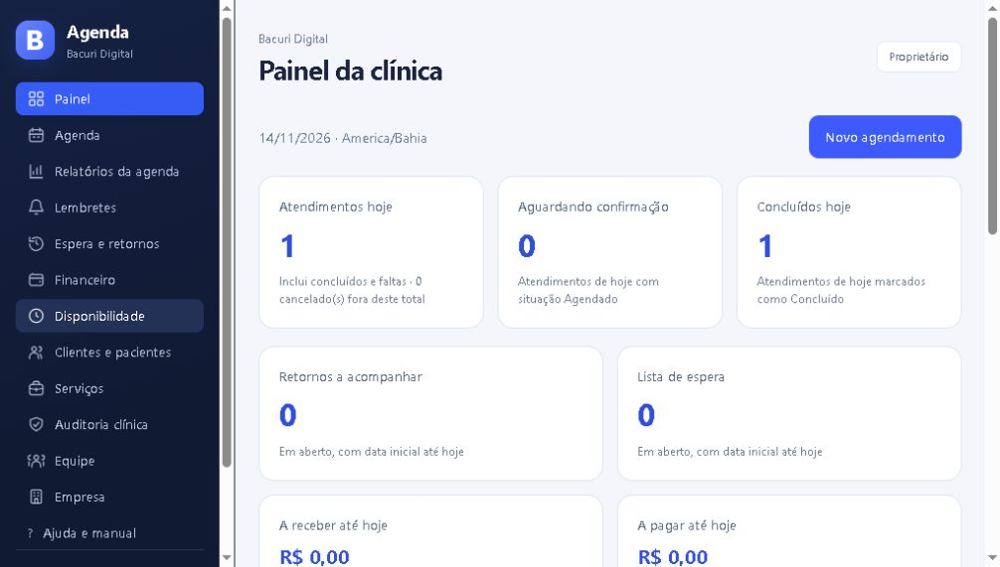
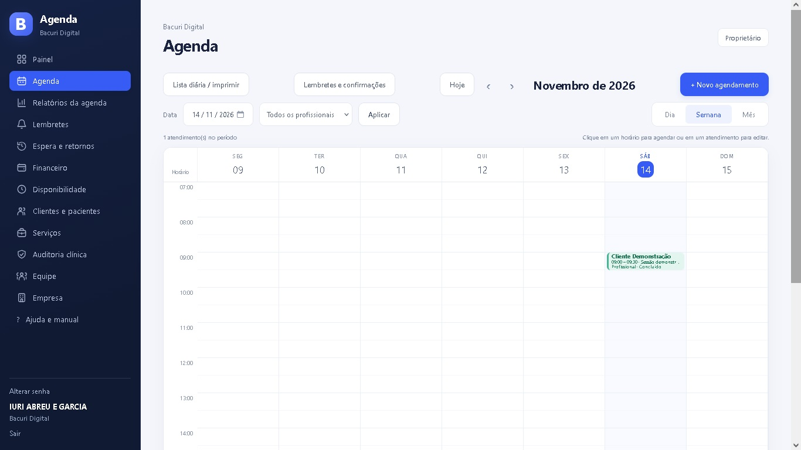
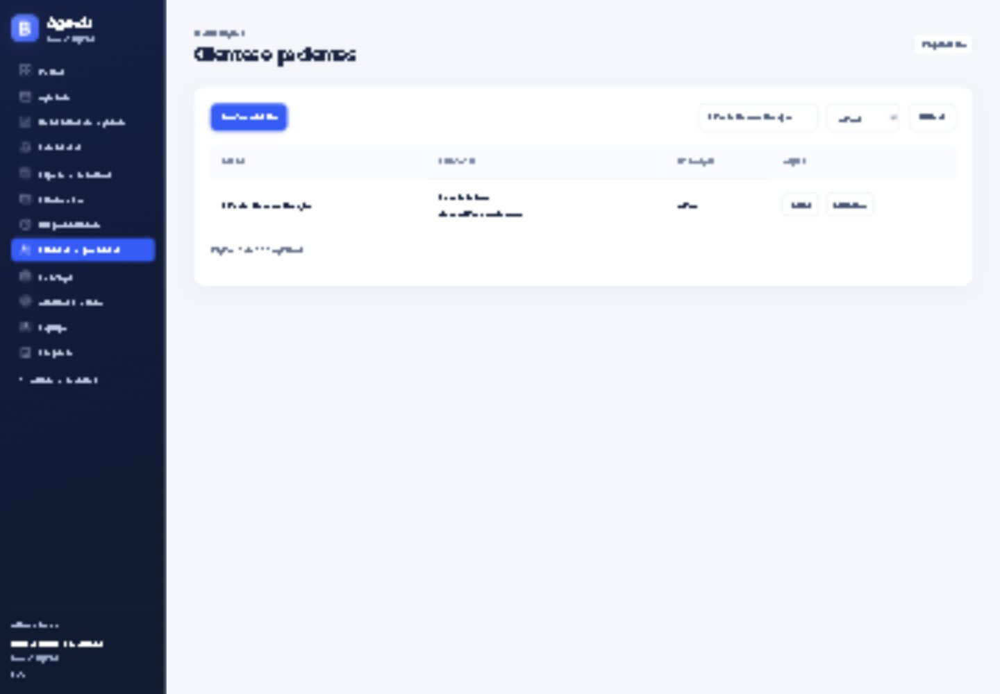
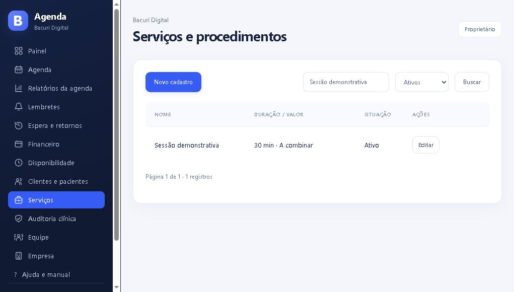

# Bacuri Agenda — clientes e serviços (V2)

Base: ZIP agenda-codigo-20260925-195225 enviado da Softhost. As migrações existentes e a configuração do domínio foram preservadas. Este ZIP contém o código completo; dependências vendor não estão incluídas. A atualização usa as dependências já existentes, sem composer update.

## Novidades

- Clientes/pacientes com nome, telefone, e-mail, busca, paginação, arquivamento e reativação.
- Histórico dos atendimentos vinculados ao cadastro.
- Serviços/procedimentos com duração sugerida e preço opcional em reais.
- Seleção de cliente e serviço na agenda, preenchimento de contato e sugestão de horário final.
- Nomes, contato e preço do atendimento são registrados como uma cópia histórica: mudar um cadastro não reescreve o passado.
- Agendamentos antigos permanecem intactos, inicialmente sem vínculo. Edite cada atendimento para vinculá-lo ao cadastro correto. Não é feita associação automática por nome ou telefone.
- Cadastro arquivado não pode ser selecionado para novo atendimento; vínculos anteriores continuam válidos.
- Correções de login, troca de senha, proteção de proprietários, validação de datas e transações contra sobreposição de horários.

Proprietário e recepção gerenciam os novos cadastros. Profissionais continuam com sua agenda e preenchimento manual; não têm acesso ao diretório de clientes ou ao histórico de outros profissionais. Cada cadastro pertence a uma empresa. Os serviços ainda não possuem restrição por profissional; a duração é uma sugestão ajustável, não uma regra de expediente. Preço registrado não representa pagamento recebido.

Não inclui prontuário/odontograma, cobrança, WhatsApp, autoagendamento público, expediente ou folgas. Esses módulos ficam para próximas etapas.

## Atualização da sua Softhost

1. Faça backup completo de /home/bacuridi/agenda-app e exporte bacuridi_agenda pelo phpMyAdmin.
2. Envie o ZIP para /home/bacuridi e extraia fora da pasta da aplicação. A pasta interna chama-se agenda-v2-clientes-servicos.
3. Execute:

```bash
bash /home/bacuridi/agenda-v2-clientes-servicos/atualizar.sh
```

O script usa /opt/cpanel/ea-php84/root/usr/bin/php, verifica os arquivos contra o ZIP enviado, salva cópia dos arquivos substituídos, ativa manutenção, copia apenas alterações previstas e executa as duas migrações novas. Cria customers e services e acrescenta campos opcionais aos agendamentos. Não executa migrate:fresh e não apaga os registros antigos. Preserva .env, APP_KEY, .htaccess e as migrações anteriores.

Se algum arquivo foi alterado no servidor depois do ZIP, a atualização para antes de copiar e mostra qual arquivo divergiu. Não force a substituição. A configuração precisa estar em APP_ENV=production e APP_DEBUG=false, com chave existente. Se necessário, ajuste apenas esses valores e execute artisan config:clear com o PHP 8.4.

O backup automático em /home/bacuridi/agenda-backups cobre arquivos, não o banco. Falhas após ativar manutenção deixam o site em manutenção. Envie a mensagem de erro sem senhas. Não execute rollback/fresh indiscriminadamente: as migrações de reversão removem os cadastros novos. Uma restauração completa deve combinar o backup de arquivos com o backup do banco do mesmo momento.

## Depois de atualizar

Entre com o acesso existente. Cadastre um cliente e um serviço nos novos menus. Crie um atendimento selecionando ambos. Confira o histórico do cliente e tente cadastrar horário sobreposto para o mesmo profissional. Confira também seus agendamentos antigos. Arquive um cadastro para verificar que o histórico permanece.

Os agendamentos já vinculados preservam dados históricos ao editar. Para trocar o vínculo, selecione outro cadastro; para editar livremente o texto, escolha preenchimento manual. Não há importação automática de clientes antigos, pois nomes ou telefones iguais podem pertencer a pessoas diferentes.

## Ambiente e instalação nova

PHP 8.4.1+, Composer e banco MySQL/MariaDB com InnoDB. Domínio agenda.bacuridigital.com apontando para /home/bacuridi/agenda-app/public. Não precisa Node permanente, Redis ou novo cron. O fuso da aplicação existente é preservado; não altere sem conferir os horários salvos.

Somente para uma instalação nova, em diretório e banco vazios: coloque o conteúdo da pasta do pacote em agenda-app, execute bash install.sh, configure o .env criado (senha do banco, URL e fuso) e execute novamente. Depois crie a empresa:

```bash
/opt/cpanel/ea-php84/root/usr/bin/php artisan company:create "Minha Empresa" dono@exemplo.com
```

A senha é solicitada no terminal. Não execute company:create nem key:generate para atualizar uma empresa existente. Dados de acesso não estão neste pacote. storage e bootstrap/cache precisam ser graváveis pelo usuário da aplicação; não use 777.

## Validação

26 testes locais aprovados, com 121 verificações, usando SQLite em memória. Cobrem login, permissões, isolamento de empresas, cadastros, histórico, arquivamento, preços e conflitos de horários. Os testes não usam o banco de produção. A concorrência real do MariaDB e o funcionamento na sua conta Softhost precisam ser conferidos após implantação.

O atualizador também foi executado com sucesso em uma cópia local do ZIP enviado, com banco SQLite: backup de arquivos, manutenção, testes, duas migrações novas e reconstrução dos caches. Esse ensaio não substitui a verificação do banco MariaDB da hospedagem.

## Galeria do sistema

As capturas abaixo mostram as principais telas da agenda. Os exemplos de cliente, serviço e atendimento usam dados fictícios de demonstração.

<table>
  <tr>
    <td align="center" width="50%">
      <a href="docs/screenshots/dashboard.jpg"></a><br>
      <strong>Painel</strong><br>
      Resumo dos atendimentos do dia.
    </td>
    <td align="center" width="50%">
      <a href="docs/screenshots/agenda.jpg"></a><br>
      <strong>Agenda semanal</strong><br>
      Visão semanal com atendimento demonstrativo concluído às 9h.
    </td>
  </tr>
  <tr>
    <td align="center" width="50%">
      <a href="docs/screenshots/clientes.jpg"></a><br>
      <strong>Clientes e pacientes</strong><br>
      Cadastro fictício filtrado para a captura.
    </td>
    <td align="center" width="50%">
      <a href="docs/screenshots/servicos.jpg"></a><br>
      <strong>Serviços e procedimentos</strong><br>
      Serviço demonstrativo com duração de 30 minutos.
    </td>
  </tr>
</table>
